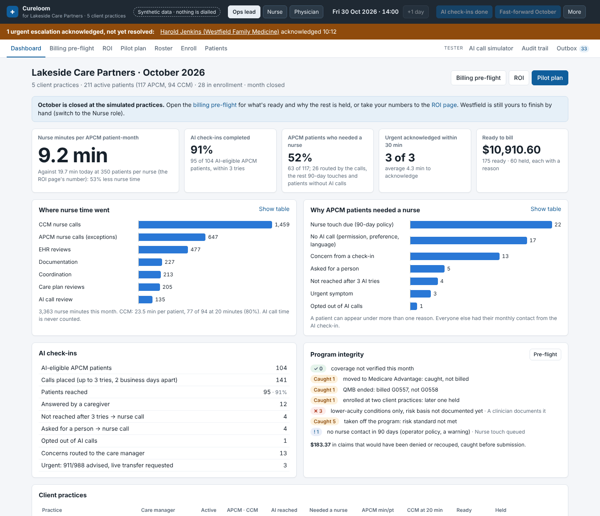
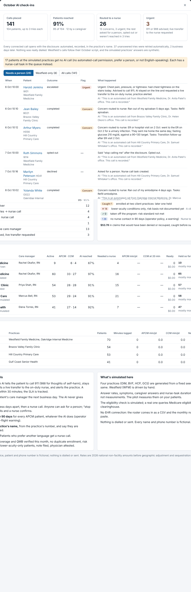
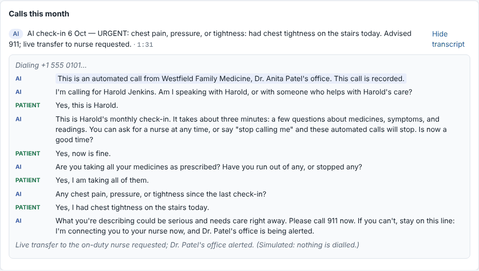
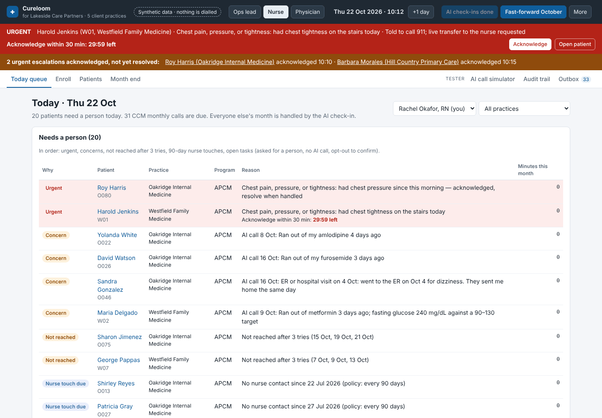
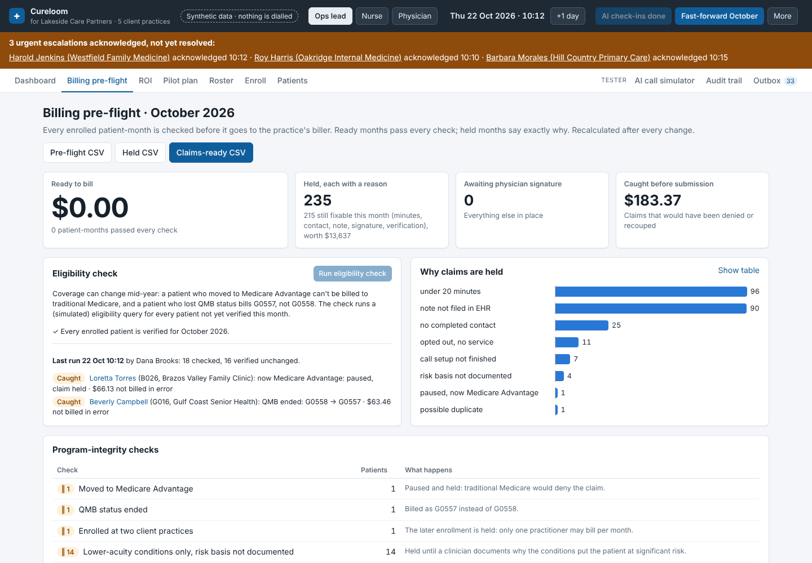
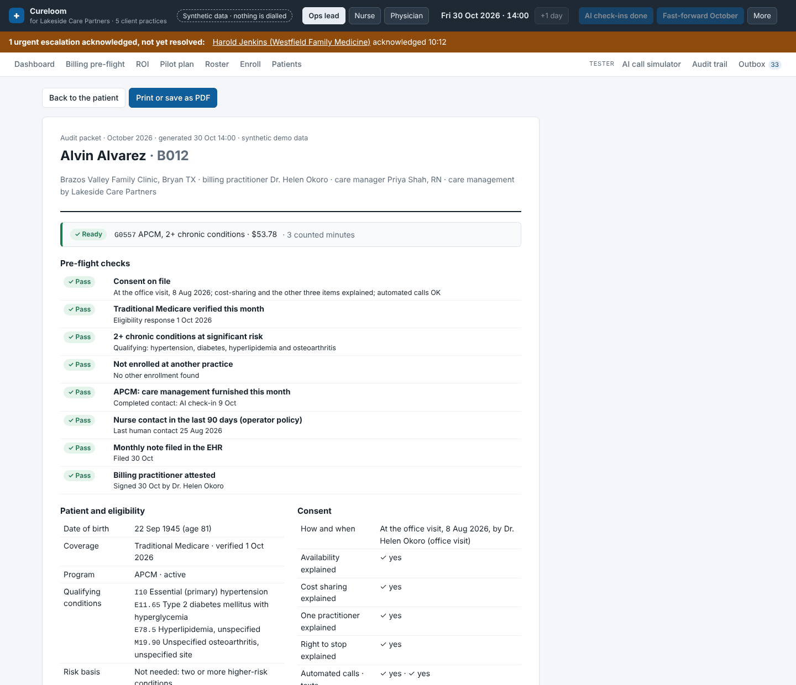
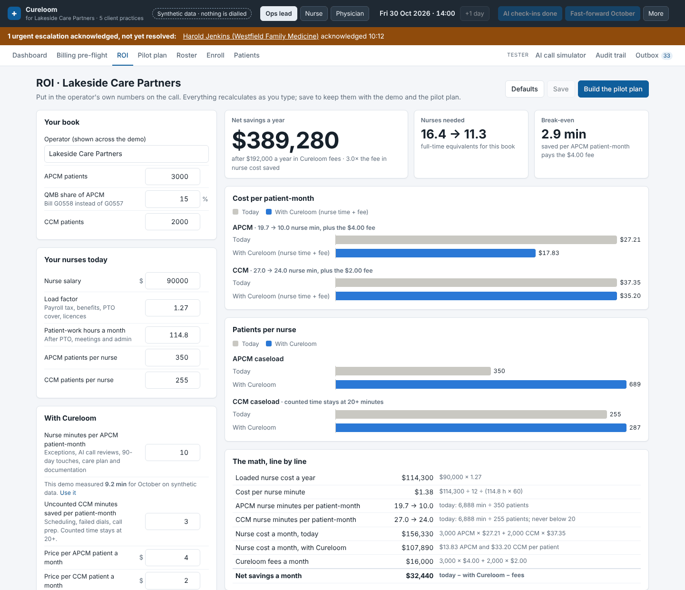
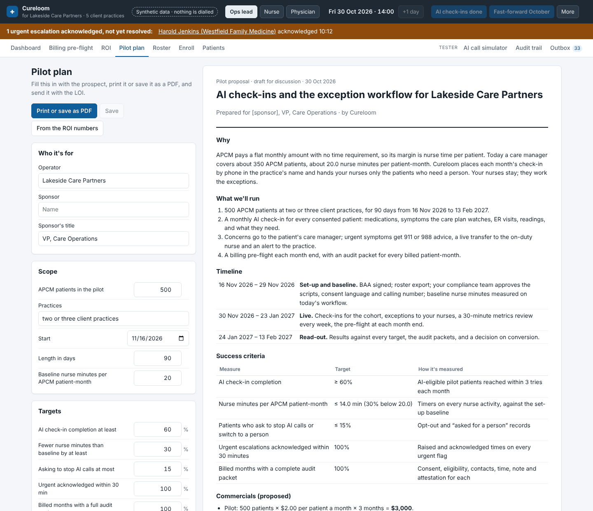

# Cureloom — operator demo

A working demo of Cureloom as software for care-management operators: ACO enablement companies, MSOs, IPAs and CCM/APCM vendors who already employ the nurses and run care management for many client practices. It is built to show a prospect, let them check the numbers, and ask for a letter of intent for a paid pilot.

The operator ("Lakeside Care Partners" by default; rename it on the ROI page) runs care management for five fictional Texas practices: 286 patients, about 218 of them active in APCM or CCM. Cureloom places each month's APCM check-in call in the practice's name, hands the nurses only the patients who need a person, checks every claim before it goes to the practice's biller, and keeps an audit packet for every billed month.

**Everything is synthetic.** Every practice, patient and phone number (+1 … 555 01XX) is fictional. Nothing is dialled, texted or sent to an EHR. Four of the five practices are generated from a fixed seed, so every reset gives the same numbers. The fifth, Westfield Family Medicine, is the original 15-patient scripted practice, which you drive by hand as the nurse and physician.

The talk track for a prospect meeting is in [docs/demo-script.md](docs/demo-script.md).

## What it looks like

These screenshots follow the demo script from a fresh seed.

| | |
|---|---|
|  |  |
| **Dashboard**, month closed | **AI check-ins**: 141 calls, 26 patients routed to a nurse |
|  |  |
| **Urgent answer**: 911, stay on the line, live transfer | **Nurse queue**: needs a person, CCM calls due, spot-checks |
|  |  |
| **Billing pre-flight** with the eligibility check | **Audit packet** for one billed month |
|  |  |
| **ROI**, every formula shown | **Pilot plan** with the non-binding LOI |

Printed samples: [pilot plan](docs/screenshots/sample-pilot-plan.pdf) and [audit packet](docs/screenshots/sample-audit-packet.pdf).

## Run it

```bash
npm install
npm start            # http://localhost:3000
```

`npm start` runs one Node process: the API and SQLite database (`data/cureloom.db`), plus the React app through Vite. The database is seeded on first start, and **More → Reset to seed** in the demo bar reloads it at any time.

For a link on a private server:

```bash
npm run build
HOST=0.0.0.0 PORT=3000 npm run serve
```

## Check it yourself in five minutes

1. `npm test`: 17 tests. They pin down the numbers a prospect sees:
   - the portfolio is identical on every reset;
   - calls go out in each practice's name;
   - an urgent answer gets the warm handoff;
   - the eligibility check catches the Medicare Advantage switch and the lost QMB status;
   - the duplicate enrollment is held;
   - a risk basis is needed for lower-acuity-only patients;
   - fast-forward ranges;
   - the ROI arithmetic, the audit packet, the API's 304 and CSV exports.
2. `npm run typecheck`.
3. `npm start`, then follow the first three steps of the demo script: **Run October AI check-ins**, the nurse queue, **Fast-forward October**. Compare the dashboard with the figures below.
4. Open the **ROI** page. Every line of the calculation is shown with its formula. Put in your own numbers.

With a fresh seed, the full month comes out like this. The "with Westfield" column means you also acknowledged Westfield's urgent alert as the nurse before fast-forwarding.

| | Value |
|---|---|
| AI check-ins | 141 calls to 104 AI-eligible APCM patients; 95 reached (91%), 12 by a caregiver |
| Routed to a nurse by the calls | 26 patients: 13 concerns, 3 urgent, 5 asked for a person, 4 not reached in 3 tries, 1 opt-out |
| APCM patients who needed a nurse for any reason | 52% (the rest of the 52% are 90-day nurse touches and patients without AI calls) |
| Nurse minutes per APCM patient-month | 9.2 (against 19.7 at the default 350 patients per nurse) |
| CCM patients at 20 minutes | 80% |
| Urgent acknowledged within 30 minutes | 3 of 3 with Westfield, 2 of 3 without |
| Ready to bill | 175 patient-months, $10,910.60 at 2026 national rates |
| Held | 60, each with a reason |
| Caught before submission | $183.37: 1 Medicare Advantage switch, 1 lost QMB status, 1 duplicate enrollment |

These are synthetic. Answer rates, symptoms and nurse-task durations are assumptions in `server/synthetic.ts`. The pilot exists to measure the real ones.

## The demo bar

- **Synthetic data · nothing is dialled** is always visible.
- **Role switcher**. There is no login.
  - **Ops lead**: Dana Brooks, the operator's operations lead. This is the default.
  - **Nurse**: Rachel Okafor, RN, the care manager for Westfield and Oakridge.
  - **Physician**: Dr. Anita Patel, Westfield's billing practitioner.
- **Demo clock**. It starts Mon 5 Oct 2026 09:00. **+1 day** moves it forward. While the app is open, time ticks in real time and stops at 18:00 each day.
- **Run October AI check-ins**. Places every scheduled APCM check-in for the month across all five practices, in time order, with retries 2 business days apart. The clock moves to the last call.
  - Westfield's patients follow their scripted answers (`seed/october-script.json`).
  - The simulated practices get synthetic answers from the seed.
- **Fast-forward October**. The simulated care team works the rest of the month at the four simulated practices: nurse calls, AI call reviews, flags, tasks, risk reviews and documentation. Then it closes the month: notes filed, physicians attest. A few notes are left unfiled and unsigned on purpose. Westfield is not touched.
- **More**:
  - **Go to date…** and **Jump to month end**.
  - **1 s = 1 min**: while a timer runs, each real second records a minute.
  - **Save checkpoint** and **Restore checkpoint**.
  - **Reset to seed**.

A red banner shows any unacknowledged urgent alert with its 30-minute countdown. A brown one lists acknowledged urgent alerts that are not yet resolved.

## Screens

| Screen | Role | Where |
|---|---|---|
| Dashboard: the portfolio's month, per practice and per care manager | Ops lead | `#/ops` |
| Billing pre-flight: every patient-month checked, eligibility check, CSV exports | Ops lead, Physician | `#/billing` |
| Audit packet: one patient-month's evidence, printable | Anyone | `#/audit/:id` |
| ROI calculator: the operator's numbers in, nurse cost and savings out | Ops lead | `#/roi` |
| Pilot plan: printable proposal with a non-binding LOI | Ops lead | `#/pilot` |
| Roster upload (Westfield's CSV) | Ops lead | `#/roster` |
| Enroll: confirm, consent script, call setup | Nurse; the Ops lead confirms | `#/enroll` |
| Today queue: needs a person, CCM calls due, optional spot-checks | Nurse | `#/queue` |
| Patient month: brief, stepper, pre-flight, risk basis, timers, tasks, flags | Nurse | `#/patient/:id` |
| Nurse call | Nurse | `#/call/:id` |
| Month end: draft note, copy, mark filed | Nurse | `#/month-end` |
| Attestation (Westfield) | Physician | `#/attestation` |
| AI call simulator: play the patient | Tester | `#/simulator` |
| Audit trail, Outbox | Anyone | `#/events`, `#/outbox` |

CSV exports:

- `/api/billing.csv`: the whole pre-flight.
- `/api/claims.csv`: claims-ready lines for the practice's biller.
- `/api/held.csv`: held months with their failing checks.

## What the pre-flight checks

Before a patient-month is ready, it must pass, in this order:

1. The program's own rule:
   - CCM: 20 counted minutes of clinical staff time.
   - APCM: a completed contact.
2. Traditional Medicare verified this month.
3. Not enrolled at another client practice. The same name and date of birth counts as a match, and the later consent is held.
4. Two or more chronic conditions that put the patient at significant risk. If the qualifying codes are lower-acuity only (hyperlipidemia, hypothyroidism, osteoarthritis, osteoporosis), a clinician must document the risk basis. This is the standard OIG's 2026 CCM audit tested.
5. QMB verified this month, for G0558 ($117.24 against $53.78 for G0557).
6. Monthly note filed in the EHR.
7. Billing practitioner attested.

Also:

- **Earlier holds.** Before these checks, a patient is held if not enrolled, paused, with call setup unfinished, or opted out with no service before stopping.
- **The 90-day nurse touch** is an operator policy, shown as a warning, never a hold.
- **Rates.** Amounts are 2026 national non-facility rates, before geographic adjustment and sequestration. The ROI page can switch to the CY2027 proposed rule (conversion factor −1.68%).

## Protocols the demo shows

- **Urgent answer.** The AI tells the patient to call 911 (988 for thoughts of self-harm), stays on the line and requests a live transfer to the on-duty nurse, and alerts the practice. The nurse acknowledges within 30 minutes; the dashboard tracks the SLA.
  - The compressed AI run re-delivers an unacknowledged alert when it finishes. The 30-minute window starts at that delivery.
  - The simulated practices' care managers acknowledge their own urgent alerts within minutes.
- **Concerns** go to the patient's care manager. The AI never gives clinical advice.
- **Retries and opt-outs.**
  - The AI tries three times, 2 business days apart, then hands over to a nurse call.
  - Anyone can ask for a person.
  - "Stop calling me" revokes consent for automated calls, and a nurse confirms by phone.
- **Calls are made in the practice's name.** They come from the practice's number and say they are automated and recorded.
- **English only.** Patients who prefer another language get a nurse call.

## How it is built

- `shared/`: domain logic used by the server and the browser.
  - ICD-10 codes and red-flag rules.
  - The keyword parser for what patients say. No LLM is needed.
  - The AI call state machine.
  - The nurse script.
  - The ROI and pilot models (`roi.ts`).
- `server/`: Express + better-sqlite3.
  - `service.ts`: every command. Each runs in a transaction, writes `event` rows and re-runs billing.
  - `synthetic.ts`: the seeded portfolio, the synthetic AI answers, and the simulated care team's month.
  - `billing.ts`: the billing decision and its pre-flight checks.
  - `views.ts`: what the UI shows. Slim patient summaries plus the dashboard in `/api/state`, served with an ETag so polling gets a 304 when nothing changed; one patient in full at `/api/patient/:id`.
  - `audit.ts`: the audit packet.
  - `note.ts`: the monthly note.
- `src/`: React screens. The client renders server state and posts commands.
- `seed/`: Westfield's roster, its September history and its October script.

## Not built

- Real telephony and a real AI voice.
- An EHR connection: the roster comes in as CSV, and notes go out as text.
- A real eligibility query: the check is simulated; a real one goes through a clearinghouse.
- Non-English check-ins.
- Logins and permissions.
- Inbound calls.
- Payments.

The demo makes no claim of HIPAA compliance, security certification or clinical validation. Those come with a BAA and a pilot.
